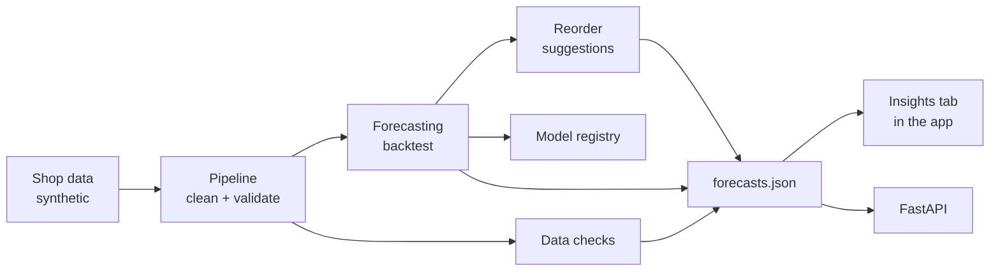

# SelfSense

Demand forecasting, data-quality checks and reorder planning added to a retail point-of-sale web app.

**Live demo:** https://selfsense-ten.vercel.app (open the **Insights** tab)

This is a demo copy of a POS/inventory app I built for my family's shop. The production app is private and is not
part of this repo. All data here is synthetic, and the copy's cloud backup and sync features are turned off.

## What it does

- Generates a realistic synthetic sales history in the app's own data format
- Cleans and validates the data, rebuilding stock levels from the app's stock ledger
- Forecasts the next 14 days of sales per product and compares four models against a simple baseline
- Flags data problems such as duplicate sales, ledger errors and unexplained stock loss
- Suggests reorder quantities and tests them in a simulation against the shop's current rule
- Retrains every week on GitHub Actions and replaces the live model only if the new one is not worse

## How it works



The app has no backend, so the pipeline runs offline and publishes a single `forecasts.json` file that the app reads.
The FastAPI service serves the same results for other systems; the app doesn't need it.

## Results

<!-- RESULTS:START -->
Updated automatically by the weekly retraining job. Data up to 2026-11-14.

### Forecast error on the last 28 days (held out)

| Model | WAPE | vs baseline | MASE | 80% range coverage |
|---|---|---|---|---|
| Seasonal naive (baseline) | 68.8% | — | 1.16 | 77.2% |
| Moving average | 52.6% | -24% | 0.89 | 75.6% |
| Holt-Winters | 48.5% | -30% | 0.84 | 74.6% |
| Gradient boosting | 47.6% | -31% | 0.82 | 76.4% |

The live model uses the best model per category, chosen on the backtest (gradient boosting for 6, holt-winters for 1 of 7 categories): 47.4% WAPE.

On festival days, gradient boosting had 40.9% WAPE vs 53.0% for the baseline. All models still under-forecast festivals.

### Reorder simulation (91 days, simulated)

| Policy | Out-of-stock product-days | Lost sales (units) | Fill rate | Avg stock held (units) |
|---|---|---|---|---|
| Current fixed rule | 134 | 937 | 88.1% | 355 |
| Forecast-based, 90% service | 38 | 253 | 96.8% | 423 |
| Forecast-based, 95% service | 23 | 171 | 97.8% | 455 |
| Forecast-based, 98% service | 22 | 161 | 98.0% | 494 |

### Data checks (against problems planted in the synthetic data)

| Check | Planted | Flagged | Precision | Recall |
|---|---|---|---|---|
| Duplicate sale | 7 | 7 | 100.0% | 100.0% |
| Credit sale no name | 11 | 11 | 100.0% | 100.0% |
| Sale at zero stock | 14 | 14 | 100.0% | 100.0% |
| Ledger balance mismatch | 11 | 11 | 100.0% | 100.0% |
| Shrinkage | 3 | 3 | 100.0% | 100.0% |
| Demand spike | 9 | 15 | 26.7% | 44.4% |
| Demand drop | 6 | 6 | 16.7% | 16.7% |

### Model history

| Version | Holdout WAPE | Previous model, same days | Result |
|---|---|---|---|
| v20261017-d3e4b23 | 49.6% | 49.6% | replaced later |
| v20261024-cf5c843 | 49.1% | 49.4% | replaced later |
| v20261031-eed90a8 | 49.3% | 49.1% | replaced later |
| v20261107-f26f9a6 | 51.4% | 51.6% | replaced later |
| v20261114-0964121 | 47.4% | 47.6% | replaced later |
| v20261114-146a28d | 47.4% | 47.4% | live |

Last week's live forecast error was 46.0% (holdout at training: 51.4%). Drift check: no drift detected.
<!-- RESULTS:END -->

## Design choices

- **Static file instead of a server.** The original app is built to run with no server and no running cost. A
  JSON file published by the weekly job keeps it that way.
- **Fair evaluation.** Models are chosen using a rolling backtest only. A final 28-day period is held back and scored
  once. Days when an item was out of stock are left out of scoring, because sales on those days don't show true
  demand.
- **Safe model updates.** A retrained model goes live only if its error on the latest holdout is within 2% of the
  current model's error on the same days.
- **Stock from the ledger.** Stock levels are rebuilt from the app's append-only stock ledger, which also makes
  ledger errors and shrinkage easy to detect.

## Run locally

```bash
pip install -r requirements-dev.txt
python -m mlops.retrain --as-of 2026-10-31   # full pipeline, about 2 minutes
pytest -q
python -m http.server -d app 8080            # then open http://localhost:8080
docker build -f api/Dockerfile -t selfsense-api . && docker run -p 8000:8000 selfsense-api
```

## Repo layout

```
app/           the web app, the Insights tab and published results
pipeline/      synthetic data generator and data cleaning
forecasting/   models and backtesting
quality/       data checks
inventory/     reorder policy and simulation
mlops/         weekly retraining, model registry, monitoring
api/           FastAPI service and Dockerfile
tests/         unit tests and browser tests
```

## Limitations

- Trained and tested on synthetic data only. Results on real shop data are likely to be weaker.
- Daily sales per product are small numbers, so product-level error stays high even for the best model.
- The rule-based data checks match how problems were planted in the synthetic data, so their perfect scores are
  expected. The spike and drop detector is weak.
- The reorder simulation ignores real-world limits such as minimum order sizes and cash flow.
- The weekly job advances a simulated calendar that ends in June 2027.

## License

MIT
